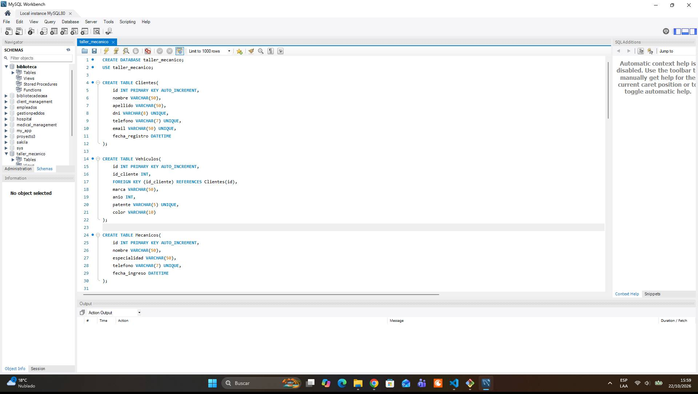

# mechanic-workshop-api
<h1 aling="center">Sistema de gestion de taller mecanico</h1>
<h2>API REST desarrollada con Node.js, Express y MySQL para administrar las operaciones de un taller mecánico</h2>

 <h3>Funcionalidades</h3>

CRUD de clientes, vehículos, mecánicos, servicios y repuestos.

Gestión de órdenes de trabajo y sus detalles.

Validaciones y reglas de negocio.

Control de stock y cálculo de totales.

Consultas SQL con JOIN, subconsultas, agregaciones y transacciones.

Manejo de errores y arquitectura por capas.

<h3>Tecnologías</h3>

Node.js

Express.js

MySQL

mysql2

JavaScript
  

<h2>PROYECTO FINALIZADO</h2>

